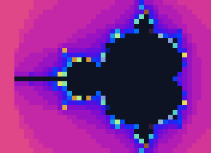

# Tab Lab

**[Fly the CUDA tunnel](https://vitaliiznak.github.io/tab-lab/)** · [Build the Rust + CUDA fractal](https://vitaliiznak.github.io/tab-lab/rust/?example=fractal) · [CUDA terminal](https://vitaliiznak.github.io/tab-lab/cuda/) · [Rust playground](https://vitaliiznak.github.io/tab-lab/rust/) · [DuckDB](https://vitaliiznak.github.io/tab-lab/data/)

Each lab boots a real, isolated ARM64 Linux guest inside the browser tab. The browser downloads static assets. Your device executes the programs, and the guest has no internet connection. [Inspect a live guest](https://vitaliiznak.github.io/tab-lab/cuda/?inspect=1) to read the kernel version, network interfaces and a route lookup from Linux itself. Open the comparison tab to see a different boot ID and check for the first guest’s temporary file. The Mandelbrot example compiles Rust, translates its CUDA kernel to WGSL with Python, builds the C bridge with GCC, and draws the results in the terminal.

- **CUDA fly-through** boots by default on the homepage. The native guest program dispatches a 640 × 360 ray-marching kernel through WebGPU, then presents its output buffer directly to the canvas. Go full screen, pause, scrub to another camera position, or switch to **Ray steps** to see the iteration count per pixel. The 121-frame flight stops on completion or when the tab is hidden. Reduced-motion visits start with one frame.
- **CUDA terminal** mounts five static ARM64 programs at `/opt/cuda`. Try `vecadd`, `matmul`, `reduce`, `tunnel` or `nvidia-smi`. The adapter name comes from WebGPU. The shell also boots on devices without WebGPU, where a six-second recording shows the tunnel.
- **Rust playground** mounts the CodeMirror workspace at `/work`. The buttons and the interactive shell use the same Cargo workspace. The offline toolchain includes rustfmt, Clippy, GCC, Python and seven vendored crate dependencies. The featured Mandelbrot project exposes the Rust driver, build script and CUDA kernel in the editor. Shared links restore the edited project and active file. WebGPU is needed only for Mandelbrot.
- **DuckDB data lab** runs the ARM64 DuckDB CLI in Alpine. Inspect reported and missing quarter-hours from Zürich’s bicycle counters, then write one million synthetic sensor rows into two Parquet layouts and compare their row-group statistics. Enter your own SQL in the workbench or query the same files from the Linux shell. [Data provenance](experiments/duckdb/zurich/README.md) · [Command-line reproductions](experiments/duckdb/README.md).
- **Runtime** uses [unkernel at 040e142](https://github.com/pithings/unkernel/tree/040e142cd016da066ac018de60fcdcec3201fd24). User programs run on its emulated CPU. Cargo compiles inside the guest. The host fetches static toolchain chunks and caches them by SHA-256. Guest disk writes and source edits last for the session. Share encodes the editor contents in the URL fragment.

## Measurements

On GitHub Pages, a cold four-CPU hello build took 54.05 s after an 8.06 s boot in Chrome 157 on an M2 Max. Over localhost on the same machine, a fresh four-CPU Rust guest booted in 1.55 s. Hello took 8.68 s to build and 0.84 s to build again. Boot plus the first hello run fetched 125,046,296 bytes of image payload, including 6,839,144 bytes during boot. Browser and network speeds affect these measurements.

The complete Rust image assets occupy 299,515,203 bytes. The 4 GiB logical data disk uses 413 compressed files, each below 2 MB, plus a separate Alpine base image. The browser requests independently verified ranges and caches them across visits.

[Live CUDA screenshot](docs/flight.png) · [Per-example timings and CPU comparison](qa/measurements.md) · [DuckDB screenshot](docs/data.png) · [CUDA screenshot](docs/cuda.png) · [Rust screenshot](docs/rust.png)

## Local development

Use Node 24 and unzip. The first build downloads the pinned DuckDB CLI archive and verifies it before packaging it for the browser. From the project root, run `npm ci`, then `bash scripts/fetch-image.sh` to restore the published image or `bash image/build.sh` to build it locally. Run `npm run dev` and open the printed localhost URL. For a static build, run `npm run build` and `npm run preview`. Serve `dist/` as a directory over HTTPS or localhost. The first lab visit registers a same-origin service worker and may reload once.

The [image builder](image/README.md) documents the networked build stage, offline verification, chunk format and package notices. The browser guest never gets a network backend. The [CUDA project](cudawg/README.md) documents the supported language subset and the Node/Dawn baseline. To rerun it, install Zig as documented, then use `npm ci --prefix cudawg && make -C cudawg && npm run test:cuda`.

## Deployment

GitHub Actions verifies the published toolchain archive, builds the static pages and deploys them from `main`. All visitor downloads are served under the same site. The artifact includes a `CNAME` file for `lab.signumspace.net`. With Actions publishing, GitHub also needs the hostname saved in this repository’s Pages settings when DNS is ready. Its DNS record is `lab CNAME vitaliiznak.github.io.`.

[Licenses and corresponding source](public/licenses/index.html) · [Alpine package and crate inventory](https://vitaliiznak.github.io/tab-lab/images/packages.json).
